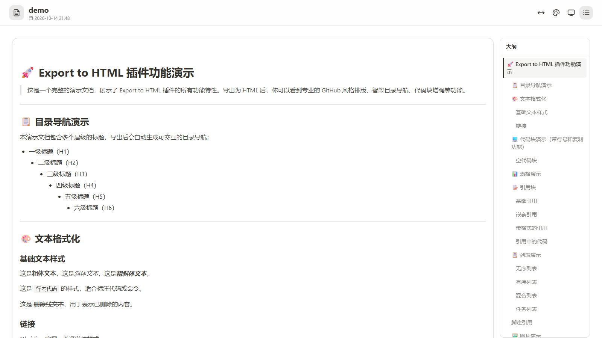

# My Export To HTML

English | [中文](README.md)

Export Obsidian notes to a single HTML file. Images, KaTeX formulas and styles are all embedded, so the result works offline and can be shared or archived as-is.

  

## Features

- Three export templates, switchable in settings:
  - v1 Classic: identical to the previous look
  - v2 Refreshed: light/dark theme (follows the system by default, toggle button in the top-right corner persists your choice), mobile-friendly layout (table of contents becomes a drawer on narrow screens), full-width content, wide tables scroll horizontally instead of squeezing columns
  - v3: mirrors the reading layout of an Obsidian Fast Note Sync share page — top toolbar (width / color scheme / theme / outline), card-style body and an outline on the right; defaults to light mode and a narrow layout, and picks its UI language from the system (Chinese or English, English as the fallback). Tables, code and formulas scroll horizontally on narrow screens; on phones the outline is collapsed by default and opens as a floating panel from the toolbar button
- Auto-generated table of contents, highlights the current section while scrolling, width adjustable by dragging (200–600px, v1/v2)
- Code blocks with line numbers and a copy button
- Images and formulas embedded as Base64 — the export is a fully self-contained single file
- Optional: open the containing folder after export
- UI language follows English or Chinese automatically

## Installation

In Obsidian: Settings → Community plugins → Browse, search for **My Export To HTML**, then install and enable it.

For a manual install, clone and build this repo, then copy `my-export-html/` into your vault's `.obsidian/plugins/` directory.

## Usage

- Right-click a Markdown file in the file explorer → "Export to HTML..."
- Or open the command palette with `Ctrl/Cmd + P` and search for `Export to HTML`

The default save location is the note's own folder; you can change it in the save dialog.

## Settings

Settings → Community plugins → My Export To HTML. Two options:

| Setting | Default | Description |
|---|---|---|
| HTML template | v3 | HTML template used for export; applies to the next export |
| Open folder after export | On | Opens the containing folder once the export succeeds |

## Preview

The v3 template in light mode with the default narrow layout (the outline on the right highlights the section you're reading):



- [v3 template demo](demo/demo-v3.html) (in a narrow/mobile viewport, click the outline button in the top bar to open the floating outline)
- [v2 template demo](demo/demo-v2.html) (use your browser's device toolbar to see the mobile layout)
- [v1 template demo](demo/demo.html)
- Demo source: [demo/demo.md](demo/demo.md)

## Development

Requires Node.js ≥ 16.

```bash
npm install
npm run build    # generate KaTeX and v3 style constants, then bundle to main.js
npm run dev      # watch mode
npm run lint
```

After building, copy `main.js` from the repo root into `my-export-html/`. That directory is the actual installable plugin, and there is no automatic sync — if you forget, your changes won't take effect (see [AGENTS.md](AGENTS.md)).

The first two steps of `npm run build` need `node_modules/katex` and `styles/v3/`; if either is missing the build stops. In that case you can run esbuild on its own — `katex-constants.ts` and `template-v3-css.ts` are both committed, so formulas and the v3 styles still work, just with the already-generated versions.

Source layout:

```
main.ts                # plugin logic: export pipeline, shared utilities, settings
template-v2.ts         # v2 template styles and shell
template-v3.ts         # v3 template: Obsidian Fast Note Sync share-page layout and interactions
template-types.ts      # template version type and heading structure
katex-render.ts        # KaTeX style/script fragments (shared by export and demo)
markdown-utils.ts      # code-region splitting and math placeholders (pure functions, no Obsidian dependency)
template-v3-css.ts     # generated, do not edit by hand
styles/v3/             # third-party CSS inlined into the v3 export
scripts/               # KaTeX and v3 style constant generators
my-export-html/        # installable plugin directory
AGENTS.md              # collaboration rules (build sync, release conventions)
```

The main conversion chain lives in `convertMarkdownToHTML()` in `main.ts`: math placeholder protection → Markdown rendering → TOC generation → images to Base64 → code block wrapping → pick the v1/v2/v3 shell based on `templateVersion`. Everything except the shell is shared between the three templates.

## License

[MIT](LICENSE) © wshRepo
