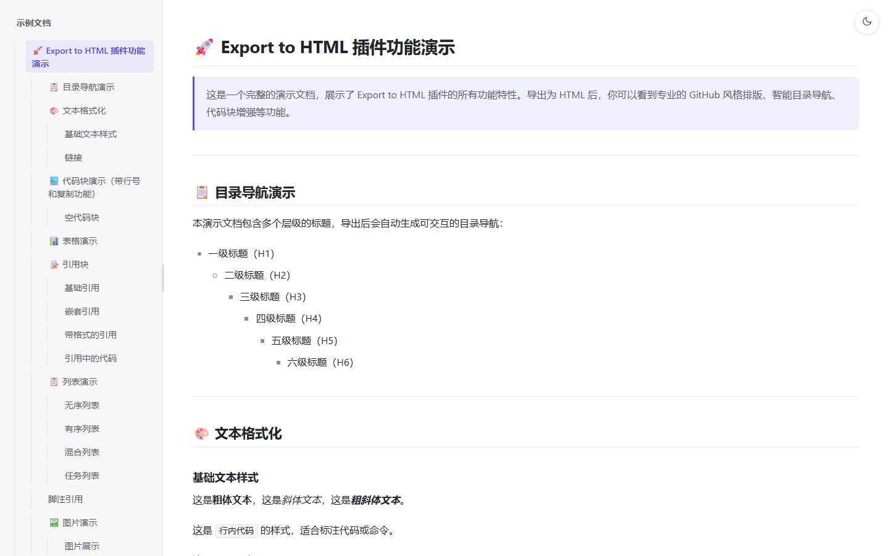

# My Export To HTML

[English](README.en.md) | 中文

将 Obsidian 笔记导出为单个 HTML 文件。图片、KaTeX 公式、样式全部内嵌，离线可用，可直接分享或归档。

  

## 功能

- 两种导出模板，可在设置中切换：
  - v1 经典：与旧版完全一致的样式
  - v2 焕新：浅色/深色主题（默认跟随系统，右上角按钮切换并记忆）、移动端适配（窄屏下目录收起为抽屉）、正文不限最大宽度、窄屏下宽表格整体横向滚动
- 自动生成层级目录，滚动时高亮当前章节，宽度可拖拽调节（200–600px）
- 代码块带行号和复制按钮
- 图片与公式以 Base64 内嵌，导出结果是完全自包含的单文件
- 导出后可自动打开所在文件夹
- 界面语言自动适配中英文

## 安装

在 Obsidian 设置 → 第三方插件 → 浏览社区插件中搜索 **My Export To HTML**，安装并启用。

手动安装则克隆本仓库构建后，把 `my-export-html/` 复制到 vault 的 `.obsidian/plugins/` 下即可。

## 使用

- 在文件浏览器中右键 Markdown 文件 →「导出为 HTML...」
- 或 `Ctrl/Cmd + P` 打开命令面板，搜索 `Export to HTML`

导出路径默认为笔记所在目录，可在保存对话框中修改。

## 设置

设置 → 第三方插件 → My Export To HTML，只有两项：

| 设置项 | 默认 | 说明 |
|---|---|---|
| HTML 模板 | 焕新（v2） | 导出使用的模板，切换后下次导出生效 |
| 导出后自动打开文件夹 | 开 | 导出成功后打开 HTML 所在目录 |

## 预览

v2 模板浅色模式（左侧目录随滚动高亮当前章节）：



- [v2 模板演示](demo/demo-v2.html)（可用浏览器开发者工具切换到手机视口查看移动端效果）
- [v1 模板演示](demo/demo.html)
- 演示源文件：[demo/demo.md](demo/demo.md)

## 开发

环境要求：Node.js ≥ 16。

```bash
npm install
npm run build    # 生成 KaTeX 常量并打包到 main.js
npm run dev      # watch 模式
npm run lint
```

构建后需要把根目录的 `main.js` 复制到 `my-export-html/`，该目录才是实际安装的插件，手动复制不等于自动同步——这一步没有捷径，忘了同步就会以为修改没生效（详见 [AGENTS.md](AGENTS.md)）。

`npm run build` 的第一步需要 `node_modules/katex`，缺失时会中断；这种情况下可以单独跑 esbuild 完成构建，`katex-constants.ts` 已提交入库，公式渲染不受影响，只是内嵌的是已生成版本的 KaTeX。

源码结构：

```
main.ts                # 插件主逻辑：导出流程、共享逻辑、设置页
template-v2.ts         # v2 模板的样式与外壳
katex-constants.ts     # 自动生成，勿手动编辑
my-export-html/        # 可安装的插件目录
AGENTS.md              # 协作规则（构建同步、发布规范）
```

核心转换链在 `main.ts` 的 `convertMarkdownToHTML()`：公式占位符保护 → Markdown 渲染 → 目录生成 → 图片转 Base64 → 代码块包装 → 按 `templateVersion` 选择 v1 或 v2 外壳。两套模板共享除外壳外的全部逻辑。

## License

[MIT](LICENSE) © wshRepo
